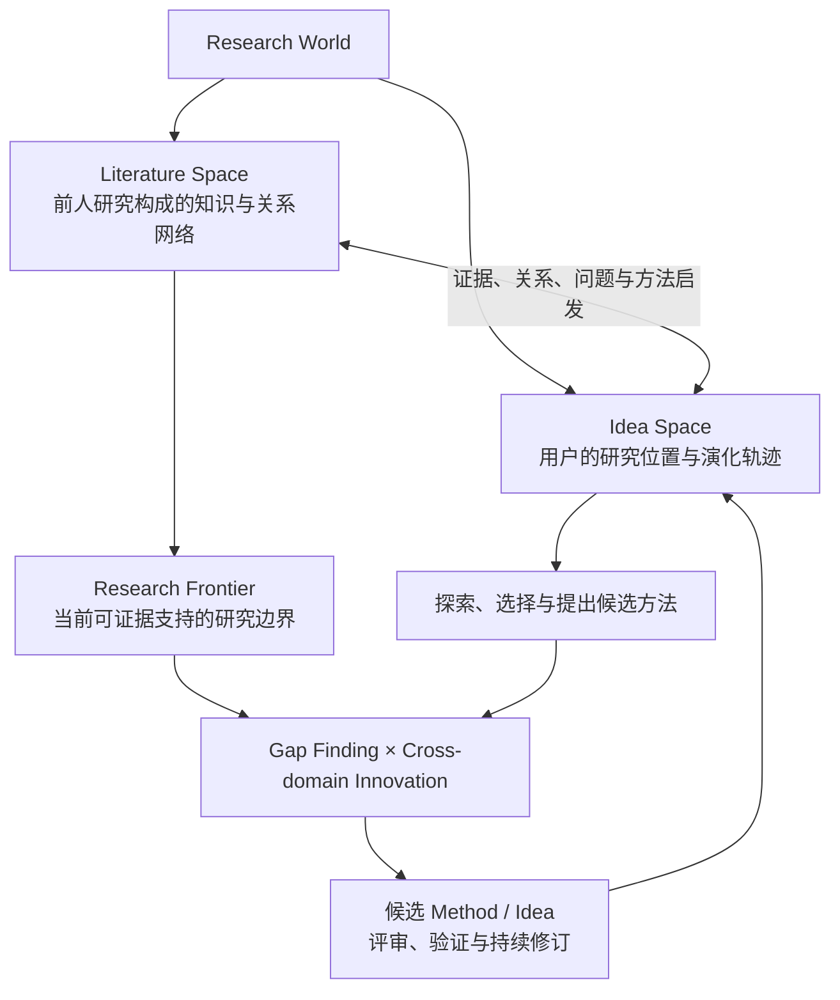
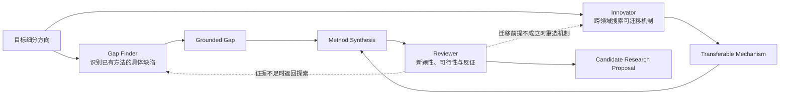

# CoResearch Community

> **Explore the Research World. Discover the frontier. Build on prior knowledge.**  
> 在前人研究构成的知识世界中探索、定位研究方向、逼近研究边界，并尝试提出有依据、可验证的新方法。

**CoResearch** 是一个面向科研探索与 Idea 发展的多智能体研究协作项目。它希望帮助研究者从模糊的研究兴趣出发，逐渐找到适合自己的细分方向，理解前人已经做到了哪里、仍有哪些限制，并在已有知识的基础上设计下一步研究。

本仓库 **CoResearch-Community** 用于社区交流、功能建议与 Bug 反馈。欢迎通过 [Issues](https://github.com/Zhanghoks/CoResearch-Community/issues) 分享体验和想法。

> **说明**：下文重点介绍 CoResearch 的产品愿景与研究工作流。它是一套持续演进的设计，不代表所有模块或 Agent 角色都已经在公开版本中完整实现。具体可用能力以实际产品为准。

## 1. 核心理念：Research World

我们把科研理解为在已有知识基础上持续探索、定位和突破研究边界的过程。

**Research World** 是统一的研究世界，由两个紧密关联的空间构成：

| 空间 | 回答的问题 | 主要内容 |
| --- | --- | --- |
| **Literature Space**（文献空间） | 前人研究了什么？知识发展到了哪里？ | 领域、子方向、论文、Problem、Method、Evaluation、Result、Limitation、研究间的关系与证据 |
| **Idea Space**（想法空间） | 当前用户在研究什么？下一步如何推进？ | 用户的研究兴趣、当前 Idea、Idea State、Research Intent、候选方法、研究判断、反馈与修订历史 |

Literature Space 不是简单的论文文件夹，而是一个**以研究问题、方法、实验和局限为关系的知识图谱式空间**。一篇论文可能关联多个问题，一个方法也可能在多个领域之间迁移。图谱中的关系应当能够追溯到真实文献和证据。

Idea Space 则描述用户在这个 Research World 中的探索轨迹：从哪里进入、逐渐定位到哪个细分领域、已经形成哪些判断，以及正在寻找怎样的研究突破。

两个 Space 相互关联、共同演化；Idea 可以引用 Literature Space 的证据，新的探索又会扩展和修正当前掌握的文献知识。**Research World 是整体，Literature Space 与 Idea Space 是其内部两个相互作用的部分。**



> Research World 并不意味着系统已经完整收录全部人类研究。它应随着检索、阅读和研究反馈逐步构建；“未检索到”不能直接等同于“前人未研究”。

## 2. 用户研究工作流

### Explore：从宽泛兴趣定位到细分研究方向

用户可以从一个宽泛的 Seed、初步问题、一篇论文或已有 Idea 开始，不必预先写好完整的研究计划。

**Explore** 以用户兴趣为导航信号，在 Research World 中逐步展开：

**Domain → Subfield → Research Direction → More Specific Direction**

系统结合已有研究、代表性论文、问题与方法的关联，帮助用户比较候选方向，并沿着最感兴趣的分支继续探索。研究方向既可以呈现层级关系，也可以与其他方向建立交叉连接。

Explore 的首要目标是**找到符合用户兴趣、能力和研究目标的具体位置**，而不是一开始就生成一篇论文 Proposal。

### Deep Dive / Deep Research：理解发展脉络并逼近 Frontier

当用户定位到某个细分研究方向后，可以通过 **Deep Dive** 和 **Deep Research** 进一步研究：

- **History**：关键问题如何被提出？主要工作与方法如何演进？
- **Methods**：现有路线采用了哪些机制？它们之间有哪些继承、改进或替代关系？
- **Evaluation**：使用了哪些 Benchmark、Baseline、Metric 和实验条件？结果能否直接比较？
- **Limitations**：现有方法在什么条件下表现不足？哪些结果尚不能支持更广泛的结论？
- **Frontier / Margin**：依据当前可获得的研究证据，哪些问题仍未充分解决、值得进一步突破？

Deep Dive 和 Deep Research 是面向用户的研究活动，不是必须按顺序执行的固定关卡。研究者可以反复探索、更换方向、补充证据或重新审视已有方法。

这里的 **Frontier** 不是把论文中的 Future Work 逐条摘录，也不是把任意 Limitation 直接称为创新机会。它需要通过接近的已有工作、真实实验边界与反面证据不断校准。

### Frontier Exploration：发现 Gap，并寻找跨领域方法迁移

在研究边界附近，CoResearch 希望借助多 Agent 协作寻找可检验的突破路径。核心思路受到 [IdeaScientist](https://arxiv.org/abs/2610.04074) 的启发：

| 协作角色 | 搜索方向 | 主要任务 |
| --- | --- | --- |
| **Research Lead / Orchestrator** | 全局协调 | 结合用户当前研究状态，选择研究问题、协调任务并解释结果 |
| **Gap Finder** | 目标领域内部 | 检查最相关的已有工作，找出具体的方法缺陷、共同限制和证据不足之处 |
| **Innovator** | 其他领域与相邻问题 | 搜索具有相似挑战的研究场景，寻找可迁移的机制与研究直觉 |
| **Reviewer** | 批判性审查 | 检查已有工作是否覆盖候选思路，以及其新颖性、可行性、迁移前提与证据 |
| **Report Writer / Synthesis** | 研究综合 | 将有依据的 Gap 和候选机制整理为 Problem、Method、Evaluation 与可证伪的研究提案 |

这一机制的核心不是随机拼接不同论文的方法，而是建立明确的推理链：

**Target Problem → Grounded Gap → Analogous Challenge → Transferable Mechanism → Candidate Method → Evaluation Plan**

例如，在某个目标方向发现现有方法无法有效处理特定类型的状态变化后，Innovator 可以进一步检索其他领域处理类似变化的机制，再分析其迁移条件和可能失败的原因。这样的组合仍然只是**候选研究方案**，必须经过近邻工作核查与实验验证，才能主张真正的边界突破。



### Idea Iteration：持续修订，而不是一次性生成 Idea

CoResearch 的目标不是把 Deep Research 的终点设为一篇静态报告，而是让每一轮研究能够影响用户的下一步行动。

- **Idea State**：用户在当前研究上下文中的位置、构想、已知与未知、证据判断和待解决问题。
- **Research Intent**：基于当前 State，下一步最值得解决的研究不确定性、选择理由以及预期完成标准。
- **Research Action**：在用户授权下实际执行的一次 Explore、Deep Dive、Deep Research 或其他具体研究任务。
- **Idea Revision**：研究带来实质变化时，保留修改内容、理由、证据、历史以及用户确认。

抽象上，整个过程是一个由证据反馈驱动的循环：

```text
Research World
    ↓
Explore → 定位研究方向
    ↓
Deep Dive / Deep Research → 逼近 Frontier
    ↓
Gap Finder + Innovator → 构造候选突破路径
    ↓
Review + Method Synthesis → 形成可验证的研究构想
    ↓
更新 Idea State → 推荐下一 Research Intent
    ↺ 用户决定是否继续探索、转向或修订
```

这一过程类似在复杂知识空间中进行**自适应导航与局部优化**，但不是具有固定目标函数的真正梯度下降：研究者可以改变假设、探索未知区域，甚至重新选择目标领域。

Agent 可以协助检索、分析、归纳、提出候选方案并记录新认识；**研究方向的关键取舍和核心 Idea 内容修改由用户掌控**。新证据应挑战或修正已有判断，而不是悄悄覆盖历史。下一步 Intent 是建议，不意味着系统自动执行下一轮研究。

## 3. 我们希望坚持的原则

1. **以用户研究目标为中心**：先帮助研究者找到合适的方向，再决定如何深化。
2. **站在前人研究之上**：每个重要判断尽可能连接到真实论文、实验条件和可追溯证据。
3. **从 Gap 走向 Method**：不仅发现尚未解决的问题，还探索解决机制及其跨领域迁移可能性。
4. **保持批判性**：区分论文陈述、Agent 推断和用户假设；不把检索缺失误判为研究空白，也不把候选方法当作已验证突破。
5. **持续演化**：保留 Idea State、Research Intent、文献关系、用户反馈和修订历史，让长期研究能够延续。
6. **人机协作，而非替代研究者**：由 Agent 承担大量信息收集与结构化工作，由研究者决定目标、判断价值并验证科学贡献。

## 4. Community：问题反馈与功能讨论

本仓库主要用于收集与 CoResearch 相关的问题、Bug 和设计建议：

- [提交 Bug](https://github.com/Zhanghoks/CoResearch-Community/issues/new)：说明复现步骤、预期行为、实际行为，以及必要的环境信息。
- [提出功能建议](https://github.com/Zhanghoks/CoResearch-Community/issues/new)：描述真实科研场景、目前遇到的困难，以及希望改善的使用流程。
- [参与讨论](https://github.com/Zhanghoks/CoResearch-Community/issues)：欢迎讨论 Explore、Literature Space、Idea Space、Frontier Exploration、多 Agent 协作和科研知识组织方式。

提交 Issue 前，欢迎先搜索是否已有类似问题。分享日志、截图或文献材料时，请删除 API Key、账号信息、私人研究数据及其他敏感内容。

## 5. 相关研究与致谢

CoResearch 的 Frontier Exploration 与多 Agent 科研构想机制参考了以下研究思路：

- [IdeaScientist: Orchestrating Agents for Grounded Scientific Ideation](https://arxiv.org/abs/2610.04074) — 从相关研究中寻找方法 Gap，跨领域迁移机制，并将其组织为有依据的科研提案。

CoResearch 是独立的产品与研究探索项目；引用上述工作不代表作者团队参与或认可本项目。

---

**CoResearch 的长期愿景：让研究者在前人知识构成的 Research World 中找到自己的位置，看清研究边界，并与 AI 协作探索下一次可能的突破。**
